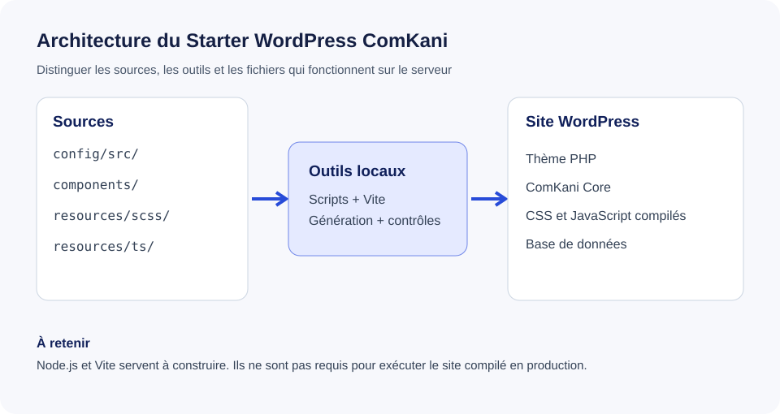

# Comprendre notre architecture

## Vue d'ensemble

Le schéma distingue ce qui sert à **développer** de ce qui sert à **faire fonctionner le site**. C'est une distinction importante : un outil présent sur nos ordinateur n'a pas nécessairement besoin d'être installé sur le serveur du client.

## Les dossiers à connaître

| Dossier | Ce qu'on y trouve | Quand y intervenir |
| --- | --- | --- |
| `config/src/` | les paramètres source du projet | initialisation ou modification de fonctionnalités |
| `config/generated/` | la configuration produite par les scripts | **ATTENTION :**  ne pas éditer directement |
| `components/` | les composants réutilisables du thème | ajout ou adaptation d'un composant |
| `packages/comkani-core/` | les fonctions propriétaires de l'agence sur WordPress | évolution d'une fonctionnalité transversale |
| `resources/scss/` | le système de styles source | ajustement des styles |
| `resources/ts/` | les interactions front-end | développement d'un comportement interactif |
| `scripts/` | les outils de génération, de contrôle et de packaging | maintenance de l'outillage |
| `assets/build/` | les fichiers compilés livrables | vérifier le build, **ATTENTION :** ne pas modifier directement |
| `docs/` | le guide interne destiné à l'équipe | mise à jour des connaissances et procédures |

## Notre règle source / généré

Nous modifions les **sources**, puis nous régénérons les fichiers produits automatiquement. Corriger un fichier généré directement ferait perdre le changement à la prochaine compilation, donc faire **ATTENTION** à ne pas modifier les fichiers générés.

## Pour aller plus loin

Consulte « Configuration », « Composants » et « Commandes » pour comprendre chaque partie séparément.
